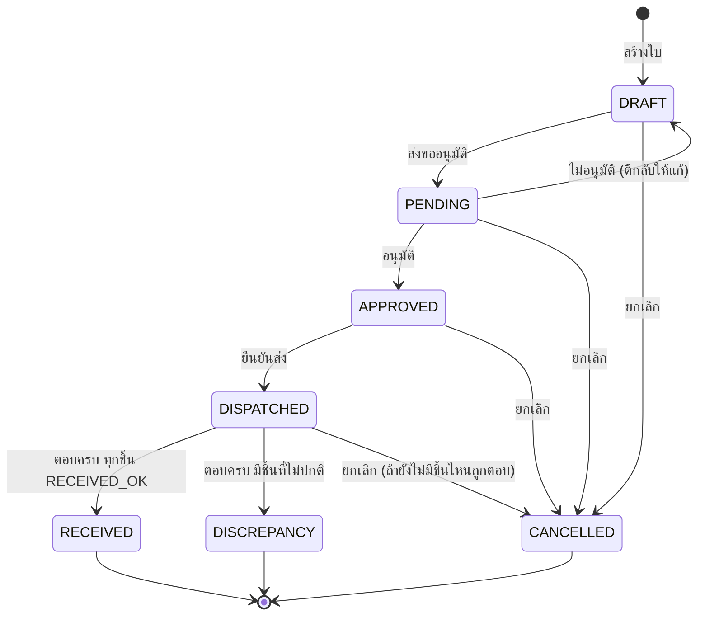
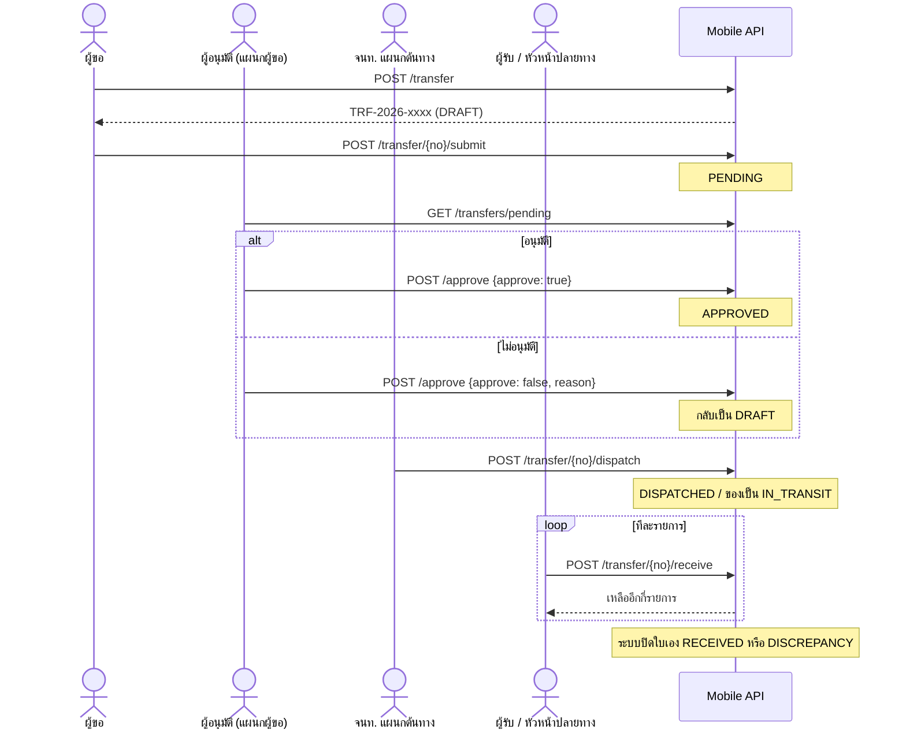

# Use Case: โอนย้ายทรัพย์สิน

อ้างอิงกติกาจาก `TPL_AssetTransfer_API_CheatSheet.xlsx` และ swagger ของ Mobile API
(`https://internal.thaiparcels.com:1160`) เทียบกับโค้ดในแอป (`lib/page/asset/`)
ณ วันที่ 8 ต.ค. 2026

จุดที่แอปยังไม่ตรงกับ cheat sheet ทำเครื่องหมาย **⚠️ แอป** ไว้

---

## ผู้เกี่ยวข้อง (Actors)

| Actor | ทำอะไร |
|---|---|
| **ผู้ขอ** | สร้างใบ ส่งขออนุมัติ แก้ใบที่ถูกตีกลับ ยกเลิกใบ |
| **ผู้อนุมัติของแผนกผู้ขอ** | อนุมัติหรือตีกลับใบ ต้องอยู่ในตาราง approver ของ**แผนกผู้ขอ** (ไม่ใช่แผนกปลายทาง) |
| **เจ้าหน้าที่แผนกต้นทาง** | ยืนยันส่งของออก ต้องสังกัด `request_dept` บนใบ |
| **ผู้รับโอน / หัวหน้าแผนกปลายทาง** | ยืนยันรับของทีละรายการ |
| **ผู้ดูแลระบบ** | ตั้งผู้อนุมัติของแต่ละแผนก |
| **ระบบ** | ปิดใบเองเมื่อตอบรับครบทุกรายการ คำนวณ `can_*` |

**กติกาพยาน**
- ผู้ขออนุมัติใบของตัวเองไม่ได้
- ผู้ยืนยันรับต้องไม่ใช่คนเดียวกับผู้ยืนยันส่ง (ต้องมีพยาน 2 คนเสมอ)

---

## สถานะของใบ



- **ไม่อนุมัติไม่ได้ทำให้ใบจบ** ใบกลับไปเป็น DRAFT ให้ผู้ขอแก้แล้วส่งใหม่
- **DISCREPANCY** คือใบที่ปิดแล้วแต่มีของผิดปกติ ต้องมีคนตามเรื่องต่อนอกระบบ
- ยกเลิกได้จนกว่าจะมีรายการแรกถูกตอบรับ หลังจากนั้นต้องตอบให้ครบ

## สถานะของทรัพย์สินระหว่างทาง

| จังหวะ | สถานะทรัพย์สิน | ผู้ถือครอง | สาขา/แผนก |
|---|---|---|---|
| ก่อนโอน | `IN_STOCK` หรือ `IN_USE` (โอนได้แค่สองสถานะนี้) | เดิม | ต้นทาง |
| ยืนยันส่ง | `IN_TRANSIT` | ล้างเป็น NULL | ต้นทาง |
| รับ `RECEIVED_OK` | `IN_USE` | `to_custodian` ถ้าระบุไว้ | ปลายทาง |
| รับ `RECEIVED_DAMAGED` | `REPAIR` | | ปลายทาง |
| รับ `NOT_ARRIVED` | `LOST` (ตัดเป็นของหายทันที) | | |
| รับ `REJECTED` | คง `IN_TRANSIT` | | ไม่เปลี่ยน (ของกำลังกลับต้นทาง) |

---

## ลำดับการทำงาน



---

## UC-01 สร้างใบโอนย้าย

| | |
|---|---|
| **Actor** | ผู้ขอ (ต้องมีสิทธิ์ `TRANSFER_CREATE`) |
| **API** | `POST /transfer` → สถานะ DRAFT |
| **หน้าจอ** | `transfer_create_page.dart` |

**ขั้นตอนในแอป**
1. เลือกทรัพย์สิน ใส่ได้หลายชิ้น
2. เลือก **ผู้รับปลายทาง** แอปดึงค่าจาก `/employee` ของคนนั้น
   - `dept_code` ใช้เป็น `to_dept_code`
   - `branch_id` ใช้เป็น `to_site_id`
3. กรอกวันที่คาดว่าถึง (ตั้งต้น +7 วัน) เหตุผล และเลข CR ถ้ามี
4. กดสร้าง จะได้เลขที่ `TRF-2026-xxxx`

```json
{
  "to_dept_code": "F0001",
  "to_site_id": "BKK10",
  "expected_arrival_date": "2026-10-15",
  "reason": "ย้ายโน้ตบุ๊กให้ทีมใหม่",
  "asset_ids": ["M150"],
  "to_custodian": "66019"
}
```

**กติกาฝั่งเซิร์ฟเวอร์**
- ของทุกชิ้นต้องอยู่แผนกเดียวกับผู้ขอ เว้นแต่มีสิทธิ์ `TRANSFER_CREATE_ANY`
- ของต้องเป็น `IN_STOCK` หรือ `IN_USE` และต้องไม่อยู่ในใบอื่นที่ยังไม่ปิด
- ของต้องมี `current_site_id` และ `current_dept_code` ในทะเบียน
- ผู้รับโอนต้องอยู่ทั้งแผนกและสาขาปลายทาง **หรือส่ง `to_custodian` เป็น null** แล้วให้หัวหน้าแผนกปลายทางรับแทน (เช่น ส่งเข้าคลัง)
- ปลายทางต้องต่างจากต้นทาง
- แผนกผู้ขอต้องมีผู้อนุมัติแล้ว
- ไม่ต้องส่ง `from_site_id` ระบบอ่านจากทะเบียนเอง
- ห้ามส่ง `cr_no` ถ้าไม่มีเลข CR จริง

**ส่งเข้าแผนกโดยไม่ระบุผู้รับ** (เช่น ส่งเข้าคลัง): กดสลับเป็น "ไม่ระบุผู้รับ"
ที่หัวช่องปลายทาง แล้วเลือกสาขาปลายทาง (จาก `/branch`) กับแผนกปลายทาง (จาก `/deptlist`) เอง
ไม่ส่ง `to_custodian` ไป หัวหน้าแผนกปลายทางจะเป็นคนรับ

ช่องเลือกผู้รับส่ง `permCode=TRANSFER_RECEIVE` ไปที่ `/employee` จึงเหลือแค่คนที่เซ็นรับได้จริง

---

## UC-02 ส่งขออนุมัติ

| | |
|---|---|
| **Actor** | ผู้ขอ (คนที่สร้างใบเท่านั้น) |
| **เงื่อนไข** | `can_submit` = ใบเป็น DRAFT และเป็นผู้สร้าง |
| **API** | `POST /transfer/{no}/submit` ไม่มี body → PENDING |

- ก่อนส่งยังแก้และลบใบได้ (`can_edit`) หลังส่งแก้ไม่ได้
- ใบจะไปโผล่ในคิวผู้อนุมัติทันที

> ⚠️ **แอป / backend**: cheat sheet บอกว่าแก้ใบ DRAFT ได้ แต่ swagger ไม่มีเส้นแก้หรือลบใบ
> แอปอ่าน `can_edit` มาแล้วแต่ไม่ได้ใช้

---

## UC-03 อนุมัติ / ไม่อนุมัติ

| | |
|---|---|
| **Actor** | ผู้อนุมัติของ**แผนกผู้ขอ** ที่ไม่ใช่ผู้ขอเอง |
| **เงื่อนไข** | `can_approve` = ใบเป็น PENDING |
| **API** | `POST /transfer/{no}/approve` |

- ดูคิวก่อนที่ `GET /transfers/pending` (เรียงใบที่รอนานสุดก่อน) แอปแสดงเป็นตัวเลขบนแถบหน้าหลัก
- **อนุมัติ** `{ "approve": true }` → APPROVED
- **ไม่อนุมัติ** `{ "approve": false, "reason": "…" }` → **กลับเป็น DRAFT** ให้ผู้ขอแก้แล้วส่งใหม่
- ต้องอยู่ในตาราง approver ของแผนกนั้นจริง มีแค่สิทธิ์อย่างเดียวไม่พอ

---

## UC-04 ยืนยันส่งของ

| | |
|---|---|
| **Actor** | เจ้าหน้าที่ที่สังกัดแผนกต้นทาง (`request_dept`) |
| **เงื่อนไข** | `can_dispatch` = ใบเป็น APPROVED |
| **API** | `POST /transfer/{no}/dispatch` → DISPATCHED |

```json
{ "courier_name": "ขนส่งภายใน", "tracking_no": "TRK001", "condition_out": "GOOD" }
```
- ทุกช่องไม่บังคับ ส่ง `{}` ก็ได้
- ทรัพย์สินทุกชิ้นเป็น `IN_TRANSIT` และผู้ถือครองถูกล้างเป็น NULL

---

## UC-05 ยืนยันรับของ

| | |
|---|---|
| **Actor** | ผู้รับโอน หรือหัวหน้าแผนกปลายทาง ที่ไม่ใช่ผู้ยืนยันส่ง |
| **เงื่อนไข** | `can_receive` = ใบเป็น DISPATCHED และยังมีรายการค้าง |
| **API** | `POST /transfer/{no}/receive` **ทีละรายการ** |
| **หน้าจอ** | `transfer_receive_sheet.dart` |

**ใครรับได้**
| กรณี | ใครรับได้ |
|---|---|
| ระบุ `to_custodian` | ผู้รับคนนั้น หรือหัวหน้าแผนกปลายทาง (ระบบบันทึก `received_on_behalf = true`) |
| ไม่ระบุ `to_custodian` | หัวหน้าแผนกปลายทางเท่านั้น |

**ผลการรับ — ตอบแล้วแก้ไม่ได้**
| outcome | ใช้เมื่อ | ทรัพย์สินกลายเป็น | note |
|---|---|---|---|
| `RECEIVED_OK` | ของครบ ใช้ได้ | `IN_USE` ที่ปลายทาง | ไม่บังคับ |
| `RECEIVED_DAMAGED` | ของถึงแต่เสียหาย | `REPAIR` | **บังคับ** ควรแนบรูป |
| `NOT_ARRIVED` | ของหาย | `LOST` | **บังคับ** ควรแนบรูป |
| `REJECTED` | ส่งผิดที่ / ไม่ใช่ของที่สั่ง | คง `IN_TRANSIT` | ไม่บังคับ |

```json
{ "asset_id": "M150", "outcome": "RECEIVED_OK", "condition_in": "GOOD" }
```

- Response บอกว่าเหลืออีกกี่รายการ ตอบครบแล้วระบบปิดใบเอง
- cheat sheet แนะนำให้มีปุ่ม **"รับครบทุกรายการ"** ที่ยิงทีละชิ้นให้เอง แล้วค่อยกดทีละชิ้นเฉพาะชิ้นที่มีปัญหา

ในแอป ทุกชิ้นตั้งต้นเป็น "รับปกติ" กดบันทึกครั้งเดียวก็รับครบ (ทำหน้าที่เป็นปุ่ม
"รับครบทุกรายการ") ชิ้นที่รับปกติแอปส่ง `condition_in: "GOOD"` ให้เอง

> ⚠️ **แอป**: ยังแนบรูป (`photo_path`) ไม่ได้ เพราะ AssetTransfer ไม่มีเส้นอัปโหลดรูป
> ต้องถาม backend ว่าจะให้อัปโหลดไปที่ไหน
>
> ⚠️ **แอป**: บังคับ note กับ `REJECTED` ด้วย (เข้มกว่า cheat sheet แต่ไม่ผิด)

---

## UC-06 ระบบปิดใบ

| ผลรวม | สถานะใบ |
|---|---|
| ทุกรายการ `RECEIVED_OK` | `RECEIVED` จบสมบูรณ์ |
| มีรายการอื่นปน | `DISCREPANCY` ต้องตามเรื่องนอกระบบ |

ตรวจผลได้ที่ `GET /transfer/{no}` และ `GET /asset/{id}`

แอปแสดง `DISCREPANCY` เป็นสีแดงเหมือน `CANCELLED` เพราะต้องมีคนตามเรื่องต่อ

---

## UC-07 ยกเลิกใบ

| | |
|---|---|
| **Actor** | ผู้ขอ หรือผู้อนุมัติ |
| **เงื่อนไข** | `can_cancel` = ใบยังไม่ปิด และยังไม่มีรายการใดถูกตอบรับ |
| **API** | `POST /transfer/{no}/cancel` `{ "reason": "…" }` |

- reason ต้องยาวอย่างน้อย **10 ตัวอักษร** (แอปดักไว้ก่อนส่งแล้ว)

---

## UC-08 ติดตามใบ

| ทำอะไร | API |
|---|---|
| ใบที่ยังไม่ปิด | `GET /transfers?open_only=true` |
| รายละเอียด + ปุ่มที่กดได้ | `GET /transfer/{no}` ดู `can_*` และ `pending_count` |
| คิวรออนุมัติของฉัน | `GET /transfers/pending` |
| ส่งแล้วยังไม่ถึง | `GET /transfers/aging?minDaysOverdue=3` มี `severity` และ `action_required` |
| หาใบที่มีของชิ้นนี้ | `GET /transfers?asset_id=M150` |
| ประวัติทรัพย์สิน | `GET /asset/{id}/log` |

---

## UC-09 ตั้งผู้อนุมัติ (ผู้ดูแลระบบ)

| ทำอะไร | API |
|---|---|
| หาแผนกที่ยังตั้งไม่ครบ | `GET /approvers/summary?notReadyOnly=true` |
| ดูผู้อนุมัติของแผนก | `GET /approver/{deptCode}` |
| ฉันคุมแผนกอะไรบ้าง | `GET /approvers?approverId=…` |
| เพิ่มผู้อนุมัติ | `POST /approver` (ระบบให้สิทธิ์ `TRANSFER_APPROVE` อัตโนมัติ) |
| มอบอำนาจชั่วคราว | `POST /approver` + `valid_from`, `valid_to` หมดอายุเอง |
| ปิดใช้งาน | `DELETE /approver/{dept}/{id}` ปิดคนสุดท้ายของแผนกไม่ได้ |

แนะนำให้มีผู้อนุมัติสำรอง (`approve_order = 2`) เพราะผู้อนุมัติอนุมัติใบตัวเองไม่ได้

> ⚠️ **แอป**: ปุ่มตั้งผู้อนุมัติยังไม่กั้นสิทธิ์

---

## `can_*` จาก `GET /transfer/{no}`

| Flag | true เมื่อ |
|---|---|
| `can_edit` | ใบเป็น DRAFT และคุณเป็นผู้สร้าง |
| `can_submit` | ใบเป็น DRAFT และคุณเป็นผู้สร้าง |
| `can_approve` | ใบเป็น PENDING คุณเป็นผู้อนุมัติของแผนกผู้ขอ และไม่ใช่ผู้ขอ |
| `can_dispatch` | ใบเป็น APPROVED และคุณอยู่แผนกต้นทาง |
| `can_receive` | ใบเป็น DISPATCHED ยังมีรายการค้าง คุณเป็นผู้รับหรือหัวหน้าปลายทาง และไม่ใช่ผู้ยืนยันส่ง |
| `can_cancel` | ใบยังไม่ปิด ยังไม่มีรายการถูกตอบ และคุณเป็นผู้ขอหรือผู้อนุมัติ |

แอปแสดงปุ่มตาม flag เหล่านี้ ถ้า flag เป็น true แต่กดแล้ว error แปลว่า backend ไม่ตรงกัน ให้แจ้งทีมพัฒนา

แอปใช้ permissions จาก `GET /me` ซ่อนปุ่มสร้างใบ (ปุ่ม + ในหน้าใบโอนย้าย และปุ่ม
"โอนย้าย" ในหน้ารายละเอียดทรัพย์สิน) ถ้าไม่มี `TRANSFER_CREATE` ถ้าถาม `/me` ไม่ได้
ปุ่มยังแสดงไว้ แล้วให้เซิร์ฟเวอร์ตัดสิน
